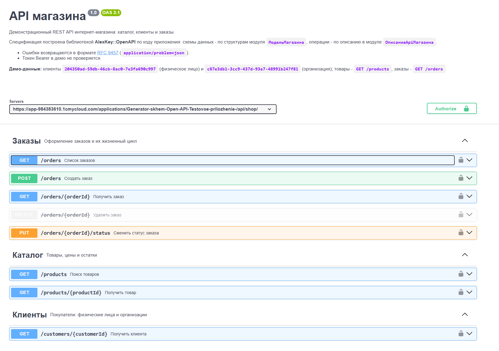
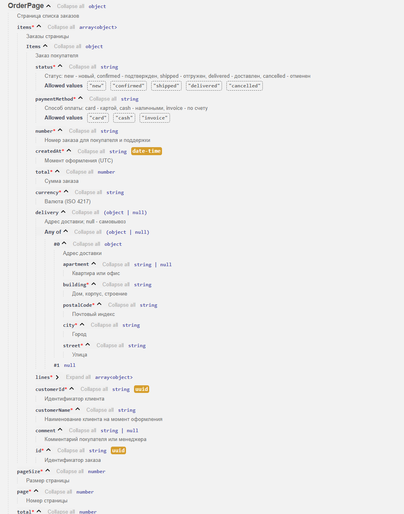

# Генератор спецификаций OpenAPI

Библиотека для **1С:Элемента** и **1С:Шины**, которая строит спецификацию **OpenAPI 3.1** для HTTP-сервисов и отдает страницу **Swagger UI**.

Схемы данных не пишутся руками: генератор читает структуры через отражение и описывает JSON ровно так, как его
записывает `СериализацияJson` - с учетом `JsonСвойство`, `JsonИгнорироватьСвойство`, `JsonЭлементПеречисления`
и необязательных полей `T?`.

Описывать необходимо только операции.





```xbsl
знч Спецификация = OpenApi.Спецификация("API магазина", "1.0",
    Операции = [
        OpenApi.Операция("GET", "/orders/{orderId}", "Получить заказ",
            Ответы = [OpenApi.Ответ(200, Тип<Заказ>), OpenApi.Ответ(404)])
    ],
    Модели = [OpenApi.Модель(Тип<Заказ>, "Order", "Заказ покупателя")],
    Параметры = [OpenApi.ПараметрПути("orderId", "Идентификатор заказа", OpenApi.Схема(Тип<Ууид>))])

Запрос.Ответ.УстановитьТело(OpenApi.СтраницаSwaggerUi(Спецификация))
```

Документация с примерами - в [руководстве разработчика](docs/guide.md).

## Содержание

- [Возможности](#возможности)
- [Подключение](#подключение)
- [Быстрый старт](#быстрый-старт)
- [Справочник API](#справочник-api)
- [Соответствие типов](#соответствие-типов)
- [Проверки описания](#проверки-описания)
- [Ограничения](#ограничения)
- [Демонстрационное приложение](#демонстрационное-приложение)
- [Структура репозитория](#структура-репозитория)
- [Лицензия](#лицензия)

## Возможности

- OpenAPI 3.1: `info`, `servers`, `tags`, `paths`, `components/schemas`, `securitySchemes`.
- Схемы по типам XBSL: простые типы, перечисления, структуры, `Массив`, `Множество`, `Соответствие<Строка, T>`,
  необязательные (`T?`) и составные типы полей, рекурсивные и взаимные ссылки структур.
- Структуры выносятся в `components/schemas` и подключаются через `$ref`; описания полей задаются по JSON-именам.
- Параметры пути из шаблона `{имя}` добавляются в операцию автоматически.
- Ответы 4xx/5xx без схемы описываются как [Problem Details (RFC 9457)](https://www.rfc-editor.org/rfc/rfc9457)
  с типом `application/problem+json`; описание ответа по умолчанию подставляется по коду.
- Дополнительные ключевые слова JSON Schema (`format`, `minimum`, `maxLength`, `examples` и т.д.) - через `Уточнить`.
- Авторизация Bearer (включена по умолчанию), устаревшие операции (`deprecated`), `operationId`.
- Страница Swagger UI со встроенной спецификацией; ресурсы Swagger UI можно брать с внутреннего зеркала.
- Ошибки описания (повтор операции, незарегистрированная модель, лишний параметр пути и т.д.) выбрасываются при
  построении спецификации.

## Подключение

Требования: 1С:Элемент или 1С:Шина, `РежимСовместимости` проекта совпадает с режимом библиотеки.

1. Скачайте файл библиотеки `.xlib` со страницы [Releases](https://github.com/AlexKeyyyy/OpenAPI-xbsl/releases).
2. Загрузите его в панель управления: **Проекты** → **+ Добавить проект** → **Загрузить проект из файла**.
   Подключить к проекту можно только релизную версию библиотеки.
3. Подключите библиотеку: в среде разработки откройте **Описание проекта** и в свойстве **Библиотеки** выберите
   `AlexKey::OpenAPI` нужной версии. В `Проект.yaml` появится зависимость:

   ```yaml
   Библиотеки:
     - Поставщик: AlexKey
       Имя: OpenAPI
       Версия: 1.0
   ```

4. Разрешите использование подсистемы библиотеки в `Подсистема.yaml` подсистемы, где описывается API:

   ```yaml
   Использование:
     - AlexKey::OpenAPI::Основное
   ```

5. Импортируйте пространство имен в модуле:

   ```
   импорт AlexKey::OpenAPI::Основное
   ```

Все публичные методы - в общем модуле `OpenApi`, типы описания - структуры `*OpenApi`.

## Быстрый старт

Типичная схема: описание API - в отдельном общем модуле, документация - два шаблона того же HTTP-сервиса.

**1. Структура-DTO.** Элемент `Структура` или `структура` в модуле - с JSON-именами полей:

```
@ВПодсистеме
структура Товар
    @JsonСвойство("id")
    пер Ид: Ууид
    @JsonСвойство("name")
    пер Наименование: Строка
    @JsonСвойство("price")
    пер Цена: Число
    @JsonСвойство("description")
    пер Описание: Строка?      // T? - допускает null и не входит в required
;
```

> Генератор создает экземпляр модели без аргументов, чтобы узнать JSON-имена полей. Поэтому у полей не должно
> быть `обз`, а поле-структуру объявляйте как `T?`.

**2. Описание API** (`ОписаниеApi.xbsl`):

```
импорт AlexKey::OpenAPI::Основное

@ВПодсистеме
метод Спецификация(): СпецификацияOpenApi
    возврат OpenApi.Спецификация(
        "API товаров",
        "1.0",
        Описание = "Каталог товаров магазина",
        Теги = [OpenApi.Тег("Товары", "Каталог и цены")],
        Модели = [
            OpenApi.Модель(Тип<Товар>, "Product", "Товар", {"id": "Идентификатор", "price": "Цена, руб."})
        ],
        Параметры = [OpenApi.ПараметрПути("productId", "Идентификатор товара", OpenApi.Схема(Тип<Ууид>))],
        Операции = [
            OpenApi.Операция("GET", "/products", "Список товаров",
                Тег = "Товары",
                Ид = "listProducts",
                Параметры = [OpenApi.ПараметрЗапроса("q", "Строка поиска")],
                Ответы = [OpenApi.Ответ(200, OpenApi.МассивИз(Тип<Товар>))]),
            OpenApi.Операция("GET", "/products/{productId}", "Получить товар",
                Тег = "Товары",
                Ид = "getProduct",
                Ответы = [OpenApi.Ответ(200, Тип<Товар>), OpenApi.Ответ(404)]),
            OpenApi.Операция("POST", "/products", "Создать товар",
                Тег = "Товары",
                Ид = "createProduct",
                Тело = OpenApi.Схема(Тип<Товар>),
                Ответы = [OpenApi.Ответ(201, Тип<Товар>), OpenApi.Ответ(400), OpenApi.Ответ(422)])
        ])
;
```

**3. Шаблоны HTTP-сервиса** (`КорневойUrl: products` → `/api/products/...`):

```yaml
ШаблоныUrl:
  - Имя: Документация
    Шаблон: /docs
    Методы:
      - Метод: GET
        Обработчик: ДокументацияGETОбработкаЗапроса
  - Имя: Спецификация
    Шаблон: /docs/openapi.json
    Методы:
      - Метод: GET
        Обработчик: СпецификацияGETОбработкаЗапроса
```

```
метод ДокументацияGETОбработкаЗапроса(Запрос: HttpСервисЗапрос)
    Запрос.Ответ.Заголовки.Установить("Content-Type", "text/html; charset=utf-8")
    Запрос.Ответ.УстановитьТело(OpenApi.СтраницаSwaggerUi(ОписаниеApi.Спецификация()))
;

метод СпецификацияGETОбработкаЗапроса(Запрос: HttpСервисЗапрос)
    Запрос.Ответ.Заголовки.Установить("Content-Type", "application/json; charset=utf-8")
    Запрос.Ответ.УстановитьТело(OpenApi.ВJson(ОписаниеApi.Спецификация()))
;
```

Откройте `/api/products/docs`. Адрес сервера по умолчанию - `"../"`: он разрешается от каталога документа
(`/api/products/docs/`), поэтому Swagger UI отправляет запросы в `/api/products/...`, и операции можно вызвать
кнопкой **Try it out**. Если документация лежит глубже, передайте `Сервер` явно, например `"../../"`.

Параметры, тела запросов, ответы и ошибки разобраны в [руководстве разработчика](docs/guide.md).

## Справочник API

Все методы - в модуле `OpenApi`. Необязательные параметры передаются по имени: `Тег = "Товары"`.

### Спецификация и операции

| Метод                                                                                                                              | Назначение                                                                                                       |
| ---------------------------------------------------------------------------------------------------------------------------------- | ---------------------------------------------------------------------------------------------------------------- |
| `Спецификация(Заголовок, Версия, Операции, Описание = "", Теги?, Модели?, Параметры?, Сервер = "../", АвторизацияBearer = Истина)` | Описание API целиком. `Параметры` - общие описания **параметров пути**; `Описание` поддерживает Markdown         |
| `Тег(Имя, Описание = "")`                                                                                                          | Группа операций в Swagger UI                                                                                     |
| `Модель(ТипДанных, Имя, Описание = "", ОписанияПолей?)`                                                                            | Регистрирует структуру в `components/schemas`. `ОписанияПолей` - по JSON-именам полей                            |
| `Операция(Метод, Путь, Кратко, Ответы, Тег = "", Описание = "", Параметры?, Тело?, Ид = "", Устарело = Ложь)`                      | Операция. `Метод` - GET, POST, PUT, PATCH, DELETE, HEAD, OPTIONS, TRACE (регистр не важен); `Ид` - `operationId` |
| `Ответ(Код, Описание = "")`                                                                                                        | Ответ без тела; для 4xx/5xx - тело `Problem` (RFC 9457)                                                          |
| `Ответ(Код, Схема, Описание = "", ТипСодержимого = "application/json")`                                                            | Ответ со схемой                                                                                                  |
| `Ответ(Код, ТипДанных, Описание = "", ТипСодержимого = "application/json")`                                                        | То же, схема по типу: `Ответ(200, Тип<Товар>)`                                                                   |
| `ПараметрПути(Имя, Описание = "", Схема?)`                                                                                         | Параметр пути; схема по умолчанию - строка                                                                       |
| `ПараметрЗапроса(Имя, Описание = "", Схема?, Обязательный = Ложь)`                                                                 | Параметр строки запроса                                                                                          |

### Схемы

| Метод                                               | Результат                                                              |
| --------------------------------------------------- | ---------------------------------------------------------------------- |
| `Схема(ТипДанных, Описание = "")`                   | Схема по типу: простой тип, структура, коллекция                       |
| `МассивИз(Элементы \| ТипЭлементов, Описание = "")` | `{"type": "array", "items": ...}`                                      |
| `ОбъектИз(Свойства, Обязательные?, Описание = "")`  | Объект с перечисленными свойствами; без `Обязательные` обязательны все |
| `Уточнить(Основа, КлючевыеСлова, Описание = "")`    | Добавляет ключевые слова JSON Schema; совпадающие ключи заменяются     |

```
// Целое число от 1 до 100, по умолчанию 20
OpenApi.Уточнить(OpenApi.Схема(Тип<Число>), <Строка, Объект?>{"type": "integer", "minimum": 1, "maximum": 100, "default": 20})

// Ответ без модели: {"items": [...], "total": 0}
OpenApi.ОбъектИз({"items": OpenApi.МассивИз(Тип<Товар>), "total": OpenApi.Схема(Тип<Число>)})
```

### Формирование

| Метод                                                                        | Результат                                                                                                                                                                                                                |
| ---------------------------------------------------------------------------- | ------------------------------------------------------------------------------------------------------------------------------------------------------------------------------------------------------------------------ |
| `ВJson(Спецификация)`                                                        | Текст спецификации в JSON                                                                                                                                                                                                |
| `СтраницаSwaggerUi(Спецификация, АдресРесурсов = <cdnjs swagger-ui 5.18.2>)` | HTML-страница Swagger UI со встроенной спецификацией. `АдресРесурсов` - каталог с `swagger-ui.css`, `swagger-ui-bundle.js`, `swagger-ui-standalone-preset.js`, например внутреннее зеркало для контура без доступа к CDN |

## Соответствие типов

Форматы соответствуют JSON, который пишет `СериализацияJson` с настройками по умолчанию.

| Тип XBSL                       | JSON Schema                                                                   |
| ------------------------------ | ----------------------------------------------------------------------------- |
| `Строка`                       | `string`                                                                      |
| `Число`                        | `number`                                                                      |
| `Булево`                       | `boolean`                                                                     |
| `Ууид`                         | `string`, `format: uuid`                                                      |
| `Дата`                         | `string`, `format: date`                                                      |
| `ДатаВремя`                    | `string`, `pattern` (платформа пишет без смещения: `2024-01-10T19:27:03.857`) |
| `Время`                        | `string`, `pattern`                                                           |
| `Момент`                       | `string`, `format: date-time`                                                 |
| `Длительность`                 | `string`                                                                      |
| `Байты`                        | `string`, `contentEncoding: base64url`                                        |
| Перечисление                   | `string` + `enum` (значения с учетом `JsonЭлементПеречисления`)               |
| Структура                      | `$ref` на модель из `Модели` спецификации                                     |
| `Массив<T>`, `Множество<T>`    | `array`                                                                       |
| `Соответствие<Строка, T>`      | `object` + `additionalProperties`                                             |
| `T?`                           | `type: [T, "null"]` (или `anyOf` с `null`); поле не входит в `required`       |
| `A\|B` (тип поля или элемента) | `oneOf`                                                                       |
| `Объект`, `Объект?`            | любое значение (`{}`)                                                         |

Имена полей берутся из `JsonСвойство`, поля с `JsonИгнорироватьСвойство` пропускаются.

## Проверки описания

При вызове `ВJson` / `СтраницаSwaggerUi` описание проверяется; ошибка - исключение
`OpenApi.ИсключениеОписания` с понятным текстом:

- операция с тем же методом и путем описана дважды; повторяется `operationId`;
- HTTP-метод не из OpenAPI;
- параметр пути отсутствует в шаблоне пути; в `Параметры` спецификации передан параметр запроса;
- повторяется имя или тип модели; модель названа `Problem` (имя занято схемой ошибки);
- структура используется, но не объявлена через `Модель`; в `Схема()` передан неподдерживаемый тип;
- у модели нет значения по умолчанию у поля (экземпляр нельзя создать без аргументов).

```
попытка
    Запрос.Ответ.УстановитьТело(OpenApi.ВJson(ОписаниеApi.Спецификация()))
поймать Ошибка: OpenApi.ИсключениеОписания
    // Ошибка в описании API: Ошибка.Описание называет операцию, модель или параметр
;
```

## Ограничения

- Схема описывает JSON, записанный `СериализацияJson` **с настройками по умолчанию**. Не описываются: пропуск
  пустых значений (`@JsonОбъект`), сведения о типе у полей составного типа (кроме `T?`), формат `Момент`,
  отличный от ISO.
- Ответ, допускающий `null`,
  описывается так: `OpenApi.Уточнить(OpenApi.Схема(Тип<Строка>), <Строка, Объект?>{"type": ["string", "null"]})`.
- Тело запроса - только `application/json`.
- Параметр пути распознается только как целый сегмент: `/items/{id}`, но не `/files/{name}.json`.
- Спецификация строится заново при каждом вызове `ВJson` / `СтраницаSwaggerUi` (отражение и сериализация моделей).
- Рекурсивные и взаимные ссылки (`Node.children → Node`, `Author → Book → Author`) описываются корректно через
  `$ref`, но Swagger UI не раскрывает ссылку, замыкающую цикл: в окне Schemas вместо модели виден `$ref` с адресом
  страницы. Это особенность отображения Swagger UI, а не ошибка спецификации.
- Схема безопасности одна - HTTP Bearer (включается флагом `АвторизацияBearer`).

## Демонстрационное приложение

Проект `AlexKey/OpenAPITestApp` подключает библиотеку и показывает ее в работе. После публикации приложения:

| Адрес                  | Что там                                                                                   |
| ---------------------- | ----------------------------------------------------------------------------------------- |
| `/api/shop/docs`       | **Пример API магазина** - полное описание REST API: заказы, каталог, клиенты              |
| `/api/docs`            | Оглавление: пример, сценарии, проверки                                                    |
| `/api/docs/{scenario}` | Swagger UI сценария, рядом `openapi.json` и `sample` - реальный JSON для сверки со схемой |
| `/api/checks`          | Результаты негативных проверок генератора: `{"passed", "failed", "results"}`              |

## Структура репозитория

```
docs/guide.md                   # руководство разработчика
AlexKey/
├── OpenAPI/                    # библиотека (ВидПроекта: Библиотека)
│   └── Основное/
│       ├── OpenApi.xbsl        # генератор: публичные методы и построение документа
│       └── *OpenApi.yaml       # структуры описания: Спецификация, Операция, Ответ, Параметр, Схема, Модель, Тег
└── OpenAPITestApp/             # тестовое приложение
    ├── Основное/               # сценарии, негативные проверки, HTTP-сервисы docs/checks/items
    └── Магазин/                # пример API магазина: HTTP-сервис shop
```

## Лицензия

[MIT](LICENSE)
